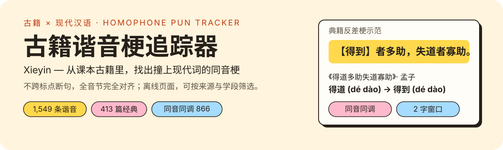

<p align="right"><a href="README.md">中文</a></p>

<p align="center">
  
</p>

<p align="center">
  <a href="https://xiaosang.cc/xieyin/">▶ Browse Online</a>
  ·
  <a href="https://github.com/holynova/xieyin">GitHub Repository</a>
</p>

Xieyin (谐音, "homophone") finds modern Mandarin homophones hiding in classical Chinese texts — the textbook classics from primary through high school plus well-known ancient works — and presents them in a filterable offline page. 413 works, 1,549 homophone matches: 得道 → 得到 (dé dào, from Mencius' 《得道多助，失道寡助》), 看道 → 看到 (kàn dào, from 《王戎不取道旁李》), 之道 → 知道 (zhī dào, from the 《三字经》). Matching never crosses punctuation and requires full-syllable alignment; results are ranked by modern spoken word frequency, context diversity, part-of-speech filters, and a curated whitelist.

## Screenshot

<p align="center">
  
</p>

## Numbers

| Dimension | Count |
|---|---|
| Works | 413 (Grade A textbooks 314 + Grade B extracurricular 99) |
| Homophone matches | 1,549 (same tone 866 + different tone 683) |
| By length | 2 characters 1,542, 3 characters 6, 4 characters 1 |
| By school stage | Primary 252, middle school 623, high school 553, more classics 121 |
| Manual review | 48 stratified samples, 79% pass rate |

All numbers come from `dist/xieyin_results.json` and the page's own statistics (v1.2.1).

## Corpus

- **Grade A · 314 textbook classics**: primary 124, middle school 124, high school 66, based on People's Education Press lists (112 primary poems, 85 middle-school poems plus 39 classical prose pieces) and the Ministry of Education's high-school Chinese curriculum appendix; modern poetry is excluded from the classical matching sources.
- **Grade B · 99 extracurricular classics**: 12 hand-picked, widely recognized classics, plus fully restored legacy sets of Tang poetry, Song ci, the Shijing, the Lunyu, the Daodejing, and ci-fu fragments across dynasties.
- **Per-work records**: school stage, grade/volume, work, author, dynasty, familiarity, textbook basis, and source text origin; public-domain ancient texts record their sources independently — textbook annotations and translations are not copied.
- **Filters**: the page merges Grade A and B by default, and filters by 「课本 / 课外经典」 ("Textbook / Extracurricular") and school stage; same-tone matches are shown by default, different-tone matches under 「包含异调」 ("Include different tones").

Textbook and hand-picked data live in `data/corpus/textbook_classics.json` and `data/corpus/more_classics.json`; the six legacy corpora remain in `data/corpus/`. A normal build only validates snapshots — it never goes online and never overwrites hand-curated data. To actively refresh the textbook text snapshots:

```bash
npm run corpus:refresh
```

## Matching Rules

- **Never crosses punctuation**: colons, quotes, brackets and the like are all boundaries, while characters such as 「兮」 in the text are never mistaken for punctuation.
- **Full-syllable alignment**: polyphonic characters are resolved against the full clause first, then 2–4 character windows are cut from the resolved pinyin sequence.
- **Stratified manual review**: review records live in `data/quality/manual_review.json`; quality metrics use pass rates sampled by stage and tone. Matches judged as failures are automatically excluded from later mining.

## Modern Lexicon

- **Primary corpus**: [SUBTLEX-CH](https://www.ugent.be/pp/experimentele-psychologie/en/research/documents/subtlexch) — film-subtitle word frequency, context diversity, and part of speech.
- **Cross-scoring**: [wordfreq](https://github.com/rspeer/wordfreq), for ranking modernity across corpora.
- **Common idioms**: the [THUOCL idiom list](https://github.com/thunlp/THUOCL), top 500 by corpus frequency only, tagged 「常用成语」 ("common idiom"); obscure idioms are not imported wholesale.
- **Curated whitelist**: new internet-life words and clear pop-culture terms, keeping low-frequency proper nouns from sneaking in automatically.

The generated structured lexicon is at `data/dictionaries/modern_lexicon.json`, with source, scoring, and attribution metadata. Old CEDICT and THUOCL files are kept as historical data only and are no longer auto-loaded by the miner. Regenerate the lexicon:

```bash
python3 -m pip install wordfreq jieba
python3 scripts/build_modern_lexicon.py
```

**Lyrics boundary**: pop-song lyrics are not shipped with the project by default. Only public-domain lyrics, lyrics with explicit permission for online distribution, or text a user types locally (never uploaded or saved) are suitable as matching sources. Song titles, artists, lyricists, and links to official pages may serve as source metadata, but metadata alone cannot take part in character-by-character homophone matching.

## Share Cards

Every match can generate a 1080 × 1440 mobile share card: the pun rewrite, the original vs. modern word, the source work, and the project's QR code built in. Save directly as PNG, or invoke the system share sheet in mobile browsers that support file sharing.

## Build & Test

```bash
npm run build   # three steps in one: prepare data → mine and export JSON → build static HTML
npm test        # regression tests (node --test)
```

Build output goes to both `dist/` and the root `index.html` — open it directly, works offline.

## Tech

- Mining engine: Node.js, pinyin via [pinyin-pro](https://github.com/zh-lx/pinyin-pro) (3.27, the only dependency).
- Build pipeline: `build.js` chains three steps — `src/prepareData.js` prepares the texts and lexicon, `src/miner.js` mines and exports `dist/xieyin_results.json`, `src/builder.js` reads the JSON and generates the single-file static page.
- Frontend: a single-file `index.html` (~1.1 MB, data embedded), warm-paper background + sticker-card style, design spec in `design.md`; no build tools, no runtime dependencies.
- Lexicon build scripts: `scripts/build_modern_lexicon.py` (Python, needs wordfreq / jieba), `scripts/build_textbook_corpus.js`.

```
build.js                    One-command build pipeline (prepare data → mine → generate HTML)
src/prepareData.js          Data preparation: texts + lexicon
src/miner.js                Homophone mining engine, exports dist/xieyin_results.json
src/builder.js              Frontend build: JSON → single-file index.html
src/engine.js  src/corpus.js  Matching core and corpus loading
data/corpus/                Textbook classics (314) + extracurricular classics + six legacy corpora
data/dictionaries/          Modern lexicon modern_lexicon.json (+ historical CEDICT / THUOCL)
data/quality/               Stratified manual review records
test/lexicon.test.js        Lexicon regression tests
design.md                   Visual design spec for the page
```
